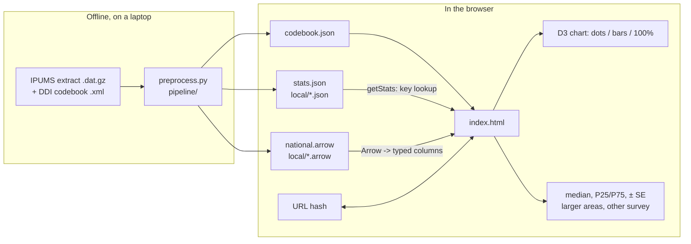

# How the American Income Explorer is built

Two halves. An offline **Python pipeline** reads the raw IPUMS survey extracts (gigabytes, never committed),
computes statistics with standard errors and writes compact data files. A **static frontend** (one HTML page
with D3 and Apache Arrow) loads those files and does everything else in the browser. There is no server: the
generated data (~85 MB) is committed and served by GitHub Pages from `docs/`.

Definitions and statistics are in [METHODOLOGY.md](METHODOLOGY.md); what to request from IPUMS is in
[EXTRACT.md](EXTRACT.md).

## Runtime

| Piece | What it uses |
|---|---|
| Chart | **D3** 7.9.2 (log scales, axes, SVG); dots placed by its own binning, not a force layout |
| Data | **Apache Arrow** 21.2.0 (`tableFromIPC`): columnar household samples read straight into typed arrays |
| Statistics | Precomputed JSON (`stats.json`, per-state local files); live weighted percentiles for views not precomputed |
| State | Every choice in the URL hash (`#src=cps&states=6&…`), so views can be bookmarked and shared |
| Libraries | D3 and Arrow from jsDelivr, pinned; nothing else |

Pipeline (offline): Python with numpy, pandas and pyarrow. Tests: pytest, Playwright for Python,
axe-playwright-python. Help clips: Playwright + Pillow.

## Files

```
preprocess.py          CLI: raw ACS and/or CPS extract + IPUMS DDI codebook -> docs/data (either survey alone)
pipeline/
  common.py            fixed-width reading by the DDI's column positions (numpy), household sums, CellStats
                       (interpolated medians, replicate-weight standard errors), stratified samples, scopes
  acs.py, cps.py       per-survey variables, code checks against the DDI labels, derived columns
geo/                   PUMA (local-area) names from Census TIGER/Line; metro names
docs/                  the site (GitHub Pages serves this folder)
  index.html           the page: markup and styles (about 600 lines)
  js/lib.js            the pure pieces: formatting, table keys, weighted quantiles, the approximate standard
                       error, sampling. Unit-tested in Node (tests/js)
  js/*.js              the rest, one file per concern, as plain scripts sharing globals and loaded in order:
                       state, load, place, filters, dots, stats, url, chart, bars, breakdown, tooltip,
                       controls, main
  help.html, help/     the guide and its animated WebP clips (tools/help_clips.py)
  data/codebook.json   labels, states, per-survey years, columns, dimensions, notes, metros, local areas
  data/<src>/          national.arrow (300,000-household sample), stats.json (precomputed cells)
  data/acs/local/      per state: <state>.json local-area stats, <state>.arrow up to 300 households per area
tests/                 pipeline tests on fake extracts, frontend tests (Playwright), axe
tools/help_clips.py    records the help page's clips
```

## How it fits together



## Core techniques

- **Reading the raw files.** IPUMS extracts are fixed-width text. The pipeline takes column positions from the
  DDI codebook and slices them with numpy, then checks every code's meaning against the DDI's labels and stops if
  IPUMS has renumbered something. Sanity checks (a year's median outside $55k–$95k, implausible shares) also stop
  the run.
- **Statistics with honest error bars.** Medians are interpolated within $2,500 intervals, as the Census Bureau
  does. Standard errors come from the surveys' replicate weights: SE = √(4/R × Σ(θᵣ − θ)²), R = 80 (ACS) or 160
  (CPS). Cells under 50 households are dropped; small ones are flagged.
- **Precompute what's asked often, compute the rest live.** Cells are keyed `scope|dim=val|…` (dims sorted)
  for the nation, states, metros and local areas, each with single dimensions and (nationally) pairs. The
  frontend builds the key for the current filters (`buildKey`, `getStats`); if it's not precomputed, it computes
  weighted percentiles from the sample (`wPercentile`) and shows them without a standard error.
- **Samples that load fast.** Each survey ships a 300,000-household stratified sample (year × state, weights
  rescaled so each stratum keeps its total) as an Arrow file; local areas load per state on demand.
- **Dots.** Incomes go on a log axis in 8-pixel bins; each bin stacks its households alternately above and below
  the center line, and every column is squeezed by the same factor so the shape stays true. Dot size follows
  survey weight.
- **Places.** One place at a time (nation, region, state, metro, local area), with its chain of larger areas
  (`placeChain`) for comparison. Switching surveys rewrites the hash and reloads; old multi-place links are
  normalized to the most specific place.

## Testing and deploy

- `pytest tests/test_preprocess.py`: the pipeline on small fake extracts (under a second): parsing, derived
  columns, medians and standard errors, suppression, the checks that should stop a bad run.
- `pytest` (all): plus Playwright at desktop and phone size against the real page and data, and axe
  accessibility checks.
- Pushing to `main` runs the full suite in GitHub Actions (the shared workflow in
  [csciuto/app-template](https://github.com/csciuto/app-template), Python mode); only if it passes is `docs/`
  published to GitHub Pages. The pipeline itself doesn't run in CI: the raw extracts are too big, which is why
  the generated data is committed.

## Loading order

A first visit needs about 6 MB (compressed): 1.3 MB of codebook and precomputed statistics, 4.8 MB of
households for the dots. `init()` starts the households' download but doesn't wait for it: as soon as the
small files arrive it builds the controls (the codebook lists each survey's columns), reads the address,
and shows the place's name and its statistics from the precomputed table (`showHeadline()`), with the
loading notice over the chart alone and the controls inert. When the households arrive the chart draws and
the controls come alive. A slice the table doesn't hold (several values of one filter) shows nothing early.

On deploy the page is stamped with its version and every script address carries it; `js/load.js` puts the
same version on the data addresses (`dataUrl`), so a reload after an update gets everything new.

## Known limits

- ACS 5-year data, 2020–2024 in 2024 dollars; the CPS covers states and large metros only.
- Views not precomputed come from the sample; their standard error is approximate (marked ≈) and is the
  sample's, which is wider than the full survey's would be.
- Capital gains aren't counted in either survey, so the very top is understated.
- The frontend's files share one set of globals (plain scripts, in order). Only `js/lib.js` is pure and
  unit-tested by itself; the rest is covered through the browser tests.
